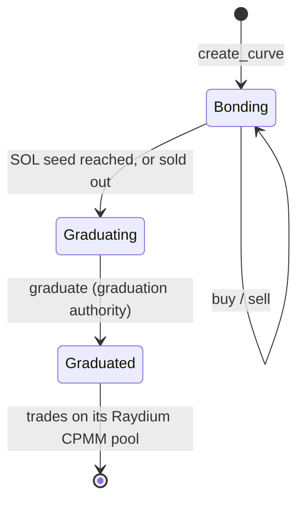

# custom-program

Anchor program behind ChiliPepper pepper.fan token launches. A token trades on a bonding curve in SOL until it graduates to a Raydium CPMM pool. The program takes every fee inside the instruction that delivers the tokens, so no fee can be stripped from a buy, and pays holder dividends from an on-chain Merkle distributor.

| | |
|---|---|
| Program ID | `CDPwGWGWbAE8FL5f2oVdzfkTutrnsKJcAcgqWktC3dwZ` (same on mainnet-beta and devnet) |
| Framework | Anchor `0.31.1` |
| IDL | [`idl/fanex_curve.json`](idl/fanex_curve.json) |
| Crate | [`programs/fanex_curve`](programs/fanex_curve) |

The program was written under the platform's earlier name, Fanex, and its identifiers keep it
(`fanex_curve`, `FanexError`, `config.fanex_fee_wallet`): they are part of the deployed interface
and of the IDL every client decodes with.

The program is upgradeable, and `main` can be ahead of the binary deployed on a cluster.

## Contents

- [How a token lives](#how-a-token-lives)
- [Fees are taken inside the trade](#fees-are-taken-inside-the-trade)
- [Launch guard](#launch-guard)
- [Creator vesting](#creator-vesting)
- [Dividends](#dividends)
- [Accounts](#accounts)
- [Instructions](#instructions)
- [Events and errors](#events-and-errors)
- [Repository layout](#repository-layout)
- [Build and test](#build-and-test)
- [Upgrading the program](#upgrading-the-program)
- [Security](#security)

## How a token lives



1. **Launch.** `create_curve` mints a fixed supply of 100,000,000 tokens (6 decimals) and splits it
   three ways: the tokens sold on the curve, the migration reserve that will seed the pool, and the
   creator's vesting allocation. It attaches Metaplex metadata (name, symbol, URI; mutable, with the
   fee wallet as update authority), then revokes the mint authority, so the supply can never grow.
2. **Bonding.** `buy` and `sell` trade against a constant-product curve with virtual reserves
   (`dy = y·dx / (x + dx)`), rounded in the pool's favour, so a buy followed by a sell can never
   extract value.
3. **Graduating.** When the curve's real SOL reserves reach the launch's CPMM seed (24 to 800 SOL),
   or the last token is sold, the curve stops trading.
4. **Graduated.** `graduate`, signed by the graduation authority, releases the vault's SOL and every
   non-vested token to accounts the authority names; the authority then seeds the Raydium CPMM pool
   with them in its own transaction. From then on the token trades on Raydium and this program no
   longer touches it.

## Fees are taken inside the trade

When a fee is a separate transfer placed in front of a swap, a buyer can build the transaction
without it. Here `buy` moves every lamport itself, in the same instruction that delivers the tokens:

- **Platform fee, 1%.** Skimmed from the buyer's `sol_in` on a buy, and from the gross SOL out on a
  sell. It goes to the platform fee wallet and never stops.
- **Fundraise split, buys only.** What is left of a buy is split by the curve's `creator_split_bps`
  (to `curve.creator`) and `fanex_split_bps` (to the fee wallet), each clamped by what remains of
  its cap; whatever a cap absorbs flows into the curve. The two caps add up to the creator's target,
  at least 16 SOL, and once both are full the whole buy goes to the curve. A launch can also have no
  split at all.
- **Destinations are bound to state.** The creator and fee wallet accounts must match `curve.creator`
  and `config.fanex_fee_wallet` (`address =` constraints); anything else fails with `AccountMismatch`.
- **Partial fill.** If a buy would take more tokens than remain, the tokens are clamped, the SOL the
  curve needs is recomputed (rounded up) and the fee re-skimmed on what was actually swapped. A buyer
  can be charged less than `sol_in`, never more.
- **Slippage.** `min_tokens_out` on a buy; on a sell, `min_sol_out` is checked against what the
  seller actually receives, after the fee.

## Launch guard

For the first 5 minutes after a curve's `created_at`, a buy is refused (`LaunchWalletCapExceeded`)
when the buyer's token account would end up holding more than 1% of the supply (1,000,000 tokens).
It counts the holding, not the single buy, so several buys from one account add up, and it binds the
launch's own first buy too. The limit is per token account: several wallets can each buy up to it.

## Creator vesting

Each launch stamps its own schedule on its `Vesting` account at `create_curve`:

- an allocation of 2% to 15% of the supply, in whole basis points;
- a cliff of up to 24 × 30 days, then a linear release over up to 48 × 30 days (a duration of `0`
  releases everything at the cliff).

`claim_vesting` pays the beneficiary what has vested minus what was already released.

**Fan-led launches.** A token can be launched for a creator who has no wallet yet. The beneficiary is
then a keyless placeholder, the PDA `["fan-led-placeholder"]`: off-curve, so nobody can spend from
it. Once the creator proves the channel is theirs, the admin calls `set_vesting_beneficiary`, which
restarts the vesting clock at the hand-over, and `sync_curve_creator`, which copies the new
beneficiary into `curve.creator`. Both refuse anything that is not still on the placeholder, so
neither can reach a curve or a vesting that belongs to a real creator. A curve whose creator is the
placeholder cannot take a fundraise split (`PlaceholderCannotRaise`): the SOL would be stranded.

## Dividends

Dividends are paid in SOL from one distributor per token per month (`month` is an `i64`, `YYYYMM`).
The funder deposits the total and commits to a Merkle root of `(claimant, amount)` leaves; each
holder claims their own leaf with a proof. Proofs are sorted-pair keccak256.

| | v1 `Distributor` | v2 `DistributorV2` (claim registry) |
|---|---|---|
| Leaf | `keccak256(claimant ‖ amount_le)` | `keccak256("fanex:dividend:v2" ‖ index_u32_le ‖ claimant ‖ amount_le)` |
| Double-claim guard | a `ClaimStatus` PDA per claim, whose rent a `rent_payer` signer fronts | bit `index` of the distributor's own bitmap (byte `index / 8`, mask `1 << index % 8`) |
| Cost of a claim | the fee plus the `ClaimStatus` rent (refunded later) | the fee only |
| Who may fund | the fee wallet | the fee wallet, the dividend payer, or `curve.creator`, with the fee wallet co-signing as `approver` |
| Size | fixed | up to 65,536 leaves |

Both versions share the PDA `["distributor", mint, month_le]`, so a month has exactly one distributor,
and every instruction refuses the other version's account.

- **Funding is gated** because the PDA can be created only once per month: anyone could otherwise
  claim a token's month first with a root of their own and block the real payout.
- **Expiry.** `expires_at` is set at funding and may be at most 400 days away (`ExpiryTooFar`).
- **Closing.** Only the funder can close a distributor, and only once it is fully claimed or past
  `expires_at`. Closing returns the rent and any unclaimed SOL to the funder; the expiry rule is what
  keeps a funder from taking back dividends that are still owed.
- **v1 rent.** After its distributor is closed, anyone may call `close_claim_status`, which returns
  the `ClaimStatus` rent to whoever paid it.

**Payout transit.** `sell` and both claims accept one optional extra account after their own list:
the PDA `["payout", source]`. The payout then reaches the user through a System Program transfer,
which explorers list as SOL received; without it the program moves the lamports directly. Any other
extra account is refused with `AccountMismatch`.

## Accounts

| Account | Seeds | Holds |
|---|---|---|
| `GlobalConfig` | `["config"]` | admin, fee wallet, graduation authority, global pause |
| `Curve` | `["curve", mint]` | creator, phase, the launch's fixed economics, virtual and real reserves, migration reserve, fundraise totals, per-curve pause, timestamps |
| `SolVault` | `["sol_vault", mint]` | the curve's SOL reserves |
| token vault | ATA of `Curve` for `mint` | the tokens for sale and the migration reserve |
| vesting vault | `["vesting_vault", mint]` | the creator's vesting tokens |
| `Vesting` | `["vesting", mint]` | beneficiary, total, released, start, cliff, duration |
| `Distributor` / `DistributorV2` | `["distributor", mint, month_le]` | root, total, claimed, funder, `expires_at`; on v2 also `leaf_count` and the claim bitmap |
| `ClaimStatus` | `["claim", distributor, claimant]` | a v1 claim, and who paid its rent |
| payout transit | `["payout", source]` | nothing between transactions |
| fan-led placeholder | `["fan-led-placeholder"]` | no account: the keyless beneficiary address |

Live accounts hold other people's SOL and off-chain readers decode them by byte offset, so a stored
layout never changes.

## Instructions

| Instruction | Signer | What it does |
|---|---|---|
| `initialize_config(fanex_fee_wallet, graduation_authority)` | the future admin | one-time setup of `GlobalConfig` |
| `update_config(new_admin, new_fanex_fee_wallet, new_graduation_authority)` | admin | each argument is optional: `None` leaves that field alone |
| `set_paused(paused)` | admin | global pause |
| `set_curve_paused(paused)` | admin | pause one curve |
| `create_curve(params)` | launcher and the new mint | checks every bound, mints the supply, attaches metadata, revokes the mint authority. The creator does not need to sign |
| `buy(sol_in, min_tokens_out)` | buyer | fee, capped split and curve buy in one instruction; may move the curve to `Graduating` |
| `sell(token_in, min_sol_out)` | seller | curve sell, 1% fee on the gross |
| `graduate()` | graduation authority | releases SOL and tokens of a `Graduating` curve to seed the pool |
| `claim_vesting()` | beneficiary | releases what has vested |
| `set_vesting_beneficiary(new_beneficiary)` | admin | moves a vesting off the fan-led placeholder |
| `sync_curve_creator()` | admin | copies that beneficiary into `curve.creator`; takes no address |
| `init_distributor(month, merkle_root, total_amount, expires_at)` | fee wallet | funds a v1 month |
| `claim_dividend(amount, proof)` | claimant and rent payer | claims a v1 leaf |
| `close_distributor()` | funder | closes a fully claimed or expired v1 month |
| `close_claim_status()` | anyone | returns a v1 claim's rent once its month is closed |
| `init_distributor_v2(month, merkle_root, total_amount, expires_at, leaf_count)` | funder, and the fee wallet as approver | funds a v2 month |
| `claim_dividend_v2(index, amount, proof)` | claimant | claims a v2 leaf |
| `close_distributor_v2()` | funder | closes a fully claimed or expired v2 month |

**What the pauses stop.** The global pause stops `create_curve`, `buy`, `sell` and both
`init_distributor`s; a curve's pause stops `buy` and `sell` on that curve. Claims, closes,
`claim_vesting` and `graduate` are never paused, so a pause cannot trap anyone's funds.

## Events and errors

Events: `CurveCreated`, `Trade`, `GraduationReady`, `Graduated`, `VestingReleased`,
`DistributorFunded`, `DividendClaimed`, `ClaimStatusClosed`, `VestingBeneficiarySet`,
`CurveCreatorSynced`. On a buy, `Trade.sol_amount` is everything the buyer was charged (curve,
creator, fee wallet and platform fee); on a sell it is what left the curve, before the fee.

Errors are numbered from 6000 in declaration order, and new ones are only ever appended, so a code
keeps its meaning across upgrades.

<details>
<summary>All error codes</summary>

| Code | Name | Code | Name |
|---|---|---|---|
| 6000 | `GloballyPaused` | 6017 | `Unauthorized` |
| 6001 | `CurvePaused` | 6018 | `StringTooLong` |
| 6002 | `NotBonding` | 6019 | `NothingToRelease` |
| 6003 | `NotGraduatable` (never raised) | 6020 | `InvalidProof` |
| 6004 | `NotGraduating` | 6021 | `AlreadyClaimed` |
| 6005 | `MathOverflow` | 6022 | `ExceedsFundedTotal` |
| 6006 | `ZeroAmount` | 6023 | `NotExpired` |
| 6007 | `SlippageExceeded` | 6024 | `VestingNotReassignable` |
| 6008 | `CurveComplete` | 6025 | `ClaimStatusFormat` |
| 6009 | `InsufficientReserves` | 6026 | `DistributorStillOpen` |
| 6010 | `CreatorTargetTooLow` | 6027 | `WrongRentRecipient` |
| 6011 | `CpmmSeedOutOfRange` | 6028 | `CurveCreatorNotSyncable` |
| 6012 | `InvalidSplitBps` | 6029 | `PlaceholderCannotRaise` |
| 6013 | `InvalidCaps` | 6030 | `InvalidLeafCount` |
| 6014 | `InvalidSupplyAllocation` | 6031 | `InvalidLeafIndex` |
| 6015 | `InvalidVestingAllocation` | 6032 | `ExpiryTooFar` |
| 6016 | `AccountMismatch` | 6033 | `LaunchWalletCapExceeded` |

</details>

## Repository layout

```
programs/fanex_curve/         the Anchor program
  src/lib.rs                  entry points and declare_id!
  src/instructions/           one file per handler
  src/math.rs                 curve, fee, vesting and Merkle math (pure, unit-tested)
  src/validation.rs           launch bounds and access rules (pure, unit-tested)
  src/payout.rs               the payout transit
  src/constants.rs            supply, fees, bounds, PDA seeds
  src/state.rs                account layouts
tests-onchain/fanex-curve/    LiteSVM tests that run the handlers against the built .so
idl/fanex_curve.json          the IDL clients build against
```

`tests-onchain/fanex-curve` is a standalone crate with its own `Cargo.lock`, so LiteSVM never
enters the program's dependency tree.

## Build and test

Build on Linux, macOS or WSL. Anchor 0.31.1 pins Solana 2.1.0, whose compiler cannot build a
transitive `edition2024` dependency, so `anchor build` fails: build the program with
`cargo-build-sbf` from a newer Solana release. It has been built with Solana 3.1.x
(platform-tools v1.52); the 4.x releases have never built it with Anchor 0.31.1.

```bash
# Unit tests: math, validation, constants
cargo test -p fanex_curve --lib --locked

# The program: target/deploy/fanex_curve.so
cargo-build-sbf --manifest-path programs/fanex_curve/Cargo.toml

# The IDL
anchor idl build -p fanex_curve -o target/idl/fanex_curve.json

# Handler tests in LiteSVM, against the .so built above
cd tests-onchain/fanex-curve
FANEX_CURVE_SO=$PWD/../../target/deploy/fanex_curve.so cargo test
```

The LiteSVM suite covers `buy` with the launch guard and the dividend instructions of both
versions. `create_curve` is not run there, since it would need the Metaplex program: the tests write
the curves they need straight into the bank.

When the interface changes, commit the new IDL in `idl/` and compare it as parsed JSON
(`jq -S`), not byte for byte. Its `address` must be the program ID: any other value means a stale
`declare_id!`.

## Upgrading the program

An upgrade keeps the program ID, so it needs the upgrade authority but no program keypair:

```bash
solana program deploy target/deploy/fanex_curve.so \
  --program-id CDPwGWGWbAE8FL5f2oVdzfkTutrnsKJcAcgqWktC3dwZ \
  --upgrade-authority <authority keypair> \
  --fee-payer <authority keypair> \
  --url <RPC url>
```

- `--program-id` takes the **address**. Never pass `target/deploy/fanex_curve-keypair.json`:
  `cargo-build-sbf` generates a new one whenever it is missing, and passing it deploys a brand-new
  program at a random address.
- Deploy to devnet first, then mainnet. `Anchor.toml` points at devnet on purpose, so mainnet is
  only ever reached with an explicit `--url`.
- After an interface change, republish the on-chain IDL, which explorers decode with:
  `anchor idl upgrade CDPwGWGWbAE8FL5f2oVdzfkTutrnsKJcAcgqWktC3dwZ --filepath idl/fanex_curve.json --provider.cluster <RPC url>`.
- Keep old clients working: append error variants, never insert them; never change a stored
  account layout; add new `CreateCurveParams` fields only after its first nine `u64`s.

## Security

- Release builds keep `overflow-checks` on: an amount that would wrap aborts the transaction.
- Every fee destination is bound to on-chain state, and every launch bound is enforced on chain
  rather than trusted from the client.
- The admin can pause trading globally or per curve, but never claims, closes or vesting.

If you find a vulnerability, please report it privately through GitHub's
[private vulnerability reporting](https://github.com/Pepperoni-team/custom-program/security/advisories/new)
rather than in a public issue.
